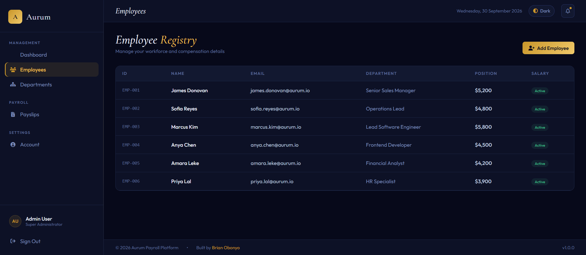
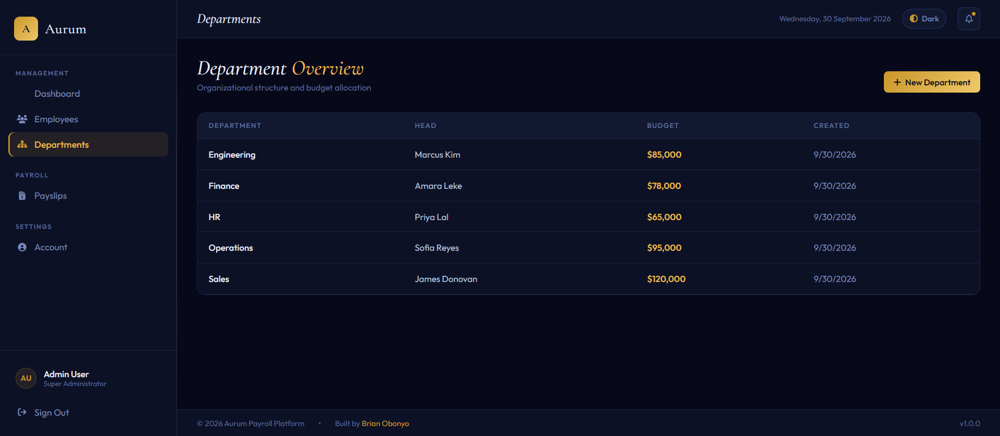
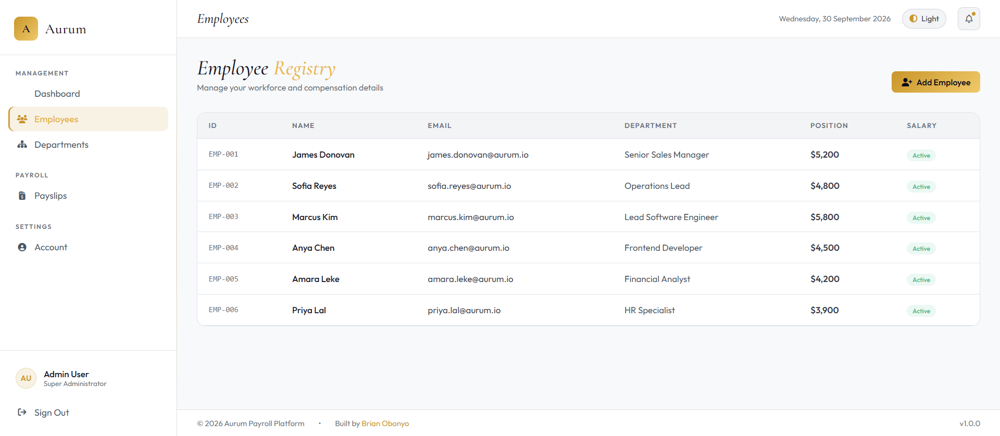

# Aurum Payroll

Aurum is a payroll administration dashboard with a React and TypeScript frontend, an Express API, and SQLite persistence. Administrators can manage employee records and departments through a responsive interface.

## Screenshots

| Employee directory — dark theme | Department overview |
| --- | --- |
|  |  |

| Employee directory — light theme |
| --- |
|  |

## Features

- Administrator sign-in with bcrypt-hashed passwords and JWT-protected API routes
- Employee records: list, create, update, and soft-delete
- Department records: list and create, including optional head and budget
- Dashboard totals for active employees, departments, and active employee salaries
- Payroll totals by department and employee-directory CSV export
- Responsive layout with a persistent light/dark theme preference
- SQLite persistence with configurable database location

Payslip generation and profile editing are not implemented yet. The payslips screen is a placeholder, and there is no report export.

## Tech stack

- **Server:** Node.js, Express
- **Database:** SQLite (`sqlite3`)
- **Authentication:** JSON Web Tokens and `bcryptjs`
- **Client:** React, TypeScript, Vite, HTML, and CSS

## Run locally

Requirements: Node.js 20.19 or newer and npm. Run these commands in a terminal from the project root (the folder containing `package.json`).

1. Install dependencies:

   ```powershell
   npm install
   ```

2. Create your private environment file, then open it:

   ```powershell
   Copy-Item env.example .env
   code .env
   ```

   Set `JWT_SECRET` to a random value of at least 32 characters, and set `ADMIN_EMAIL` and `ADMIN_PASSWORD` to credentials you choose. The administrator password must be at least 16 characters. Generate a secret with:

   ```powershell
   node -e "console.log(require('crypto').randomBytes(48).toString('hex'))"
   ```

   Save `.env` and keep it private; it is ignored by Git. Do not commit or share it.

3. Start both the Express API and Vite frontend:

   ```powershell
   npm run dev
   ```

4. Open [http://localhost:5173](http://localhost:5173) and sign in with the `ADMIN_EMAIL` and `ADMIN_PASSWORD` values you set in `.env`. Keep the terminal open while using the app. Press **Ctrl+C** in that terminal to stop both development servers.

The API runs on port `3000`; Vite serves the frontend on port `5173` and proxies API requests. The app creates its SQLite database on first run. `DB_PATH` controls its location and defaults to `./aurum_payroll.db`. Sample departments and employees are inserted when the database is initialized.

To type-check and build the production frontend, run:

```bash
npm run typecheck
npm run build
npm start
```

Express serves the compiled React app from `dist/` at [http://localhost:3000](http://localhost:3000). For more setup notes, see [SETUP.md](SETUP.md).

## API overview

All management routes require an administrator JWT. The available routes are:

| Method | Route | Purpose |
| --- | --- | --- |
| `POST` | `/api/auth/login` | Sign in |
| `POST` | `/api/auth/register` | Register a standard user |
| `GET` | `/api/auth/me` | Read the signed-in user |
| `GET`, `POST` | `/api/employees` | List or add employees |
| `GET`, `PUT`, `DELETE` | `/api/employees/:id` | Read, update, or deactivate an employee |
| `GET`, `POST` | `/api/departments` | List or add departments |
| `GET` | `/api/payslips` | List existing payslips |
| `GET` | `/api/stats/dashboard` | Read dashboard totals |

Registration creates a standard employee account; it does not grant administrator access. The current UI is designed for the configured administrator.

## Notes

This project is a portfolio/demo application, not payroll software for handling real employee data. Before production use, add deployment-specific security controls, operational monitoring, tested backups, and a persistent database strategy. Do not deploy SQLite to a host with ephemeral storage. Deployment build commands should run `npm ci && npm run build`; start the server with `npm start`.
